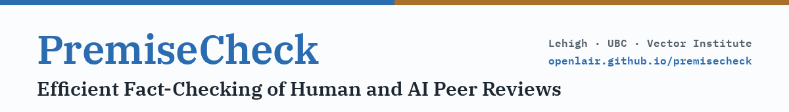
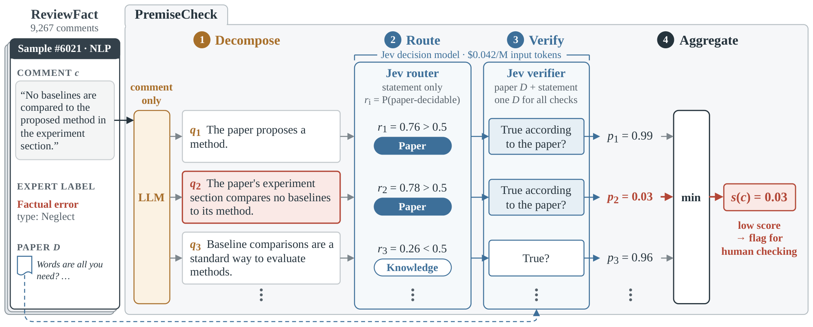
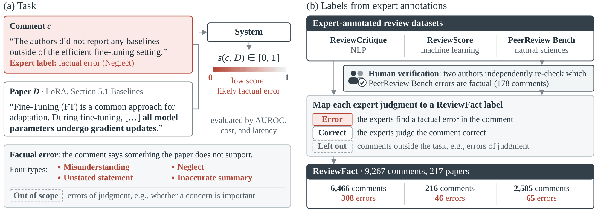

<p align="center">
  
</p>

<p align="center">
  Dingjie Song<sup>1</sup>, Zhiling Yan<sup>1</sup>, Ziqian Zhang<sup>1</sup>, Yuxuan Zhang<sup>2,3</sup>, Lichao Sun<sup>1&dagger;</sup>
  <br>
  <sup>1</sup>Lehigh University &nbsp;&nbsp; <sup>2</sup>University of British Columbia &nbsp;&nbsp; <sup>3</sup>Vector Institute
  <br>
  <sup>&dagger;</sup>Corresponding author
</p>

<p align="center">
  <a href="https://arxiv.org/abs/2610.21046"></a>
  <a href="https://www.alphaxiv.org/abs/2610.21046"></a>
  <a href="https://openlair.github.io/premisecheck/"></a>
  <a href="https://huggingface.co/datasets/songdj/ReviewFact"></a>
  <a href="LICENSE"></a>
  <a href="pyproject.toml"></a>
</p>

<p align="center">
  <a href="#overview">Overview</a> &middot;
  <a href="#install">Install</a> &middot;
  <a href="#quickstart-python">Quickstart</a> &middot;
  <a href="#command-line">CLI</a> &middot;
  <a href="#reviewfact">ReviewFact</a> &middot;
  <a href="#reproducing-the-paper">Reproduction</a> &middot;
  <a href="#citation">Citation</a>
</p>

**News.** 2026-10: the code and the ReviewFact benchmark are released.

**TL;DR.** PremiseCheck scores how likely a peer-review comment contains a factual error about the paper it reviews.
An LLM rewrites the comment as explicit premises without reading the paper. A small decision model then checks each
premise against the paper, and the comment is scored by its weakest premise. Only the decision model reads the paper,
so the expensive LLM never processes the long paper text. As a result, PremiseCheck detects errors comparably to a
frontier LLM that reads the whole paper, at a fraction of its cost. See the paper for the results on ReviewFact, a benchmark of
expert-labeled comments from NLP, machine learning and the natural sciences.

## Overview

<p align="center">
  
</p>
<p align="center"><sub>PremiseCheck on a ReviewFact sample that experts labeled as a factual error, with premises shortened for
display. Only the verifier reads the paper, and the lowest premise score, shown in red, is the comment score.</sub></p>

### How it works

1. **Decompose.** An LLM (GPT-5.5 in the paper) reads only the comment and lists the premises it relies on.
2. **Route.** For NLP and machine learning reviews, the decision model decides whether each premise can be checked
   from the paper alone (threshold 0.5) or needs general knowledge.
3. **Verify.** The decision model answers whether each premise is true, reading the paper truncated to its first
   24k tokens (o200k_base).
4. **Aggregate.** The comment score is the lowest premise probability. A comment without premises is judged as a
   whole by the decision model.

Per-field settings: NLP and machine learning reviews use routing and the verification question above. For
natural-science reviews the decomposer types each premise (paper, knowledge, opinion), only paper premises are
checked, and the decision model is asked whether the paper contradicts the premise (score = 1 - p). Optionally,
16 phrasings of the verification question are asked in one call and averaged (the last eight are inverted).

### Decision models

| decision model | how to run it | notes |
|---|---|---|
| **Kev-27B** (`jaredpalmer/kev-27b@v1.0`) | open weights, served on your own GPU; see [docs/kev.md](docs/kev.md) | the default |
| **Jev** | OpenRouter's decisions endpoint (`/api/alpha/decisions`) | requires access to that alpha endpoint |

Table 1 of the paper uses Jev. The decomposer and the holistic baseline use any OpenAI-compatible chat endpoint.

## Install

Python 3.10 or newer.

```bash
git clone https://github.com/OpenLAIR/PremiseCheck
cd PremiseCheck
pip install -e .            # or: pip install -e ".[dev]" for the tests
```

The o200k_base tokenizer used to truncate papers is downloaded by `tiktoken` on first use.

Environment variables:

| variable | used for |
|---|---|
| `OPENAI_BASE_URL`, `OPENAI_API_KEY` | decomposer and holistic LLM (any OpenAI-compatible endpoint) |
| `KEV_BASE_URL`, `KEV_API_KEY` | Kev-27B server (default `http://localhost:8000`; the key only if the server requires one) |
| `OPENROUTER_API_KEY` | Jev (optional) |

## Quickstart (Python)

```python
from premisecheck import LLM, JsonlCache, PremiseCheck, kev, truncate

llm = LLM()                       # OPENAI_BASE_URL / OPENAI_API_KEY
pc = PremiseCheck(llm, kev(), field="nlp", decomposer="gpt-5.5", effort="none")

paper = truncate(open("paper.txt").read())     # first 24k tokens, once per paper
r = pc.score("c1", "The paper does not compare against BM25.", paper)

print(r.error_score)              # higher = more likely a factual error
for p in r.premises:
    if p.p is not None:           # premises that were verified
        print(p.kind, round(p.p, 3), p.text)
print(r.usd)                      # {"decompose", "decision", "total"} in USD
```

Use `jev()` instead of `kev()` for Jev, `field="ml"` or `field="science"` for the other settings, and
`phrasings=16` for the 16-phrasing variant. `HolisticLLM(llm, "gpt-5.5", "medium")` is the holistic baseline with
the same `score()` method. Pass `cache=JsonlCache(path)` to `LLM`, `kev` or `jev` to make runs resumable; identical
requests are then answered from the file. For a decomposer without a reasoning setting, pass `effort=None`. A
complete example is in [examples/example.py](examples/example.py).

## Command line

```bash
# PremiseCheck with Kev-27B and the decomposer at reasoning effort "none"
premisecheck run      --data data/ReviewFact --source rc --decision kev --effort none --out runs/pc_rc.jsonl

# holistic GPT-5.5 baseline
premisecheck holistic --data data/ReviewFact --source rc --model gpt-5.5 --effort medium --out runs/hol_rc.jsonl

# AUROC, cost and latency, and the paired paper-bootstrap difference to a reference run
premisecheck eval     --data data/ReviewFact --source rc --scores runs/pc_rc.jsonl --ref runs/hol_rc.jsonl
```

`--source` is `rc` (NLP), `rs` (machine learning) or `prb` (natural sciences); it also selects the per-field
settings (override with `--field nlp|ml|science`). Other options of `run`: `--decision jev|kev`, `--decomposer`,
`--phrasings 1|16`, `--workers`, `--limit`, `--cache-dir`. An existing `--out` file is resumed, and requests are
cached in `.cache/`; comments that fail (for example after an API error) are left out and retried by running the same
command again. Each output line is one comment: `error_score`, `score`, the premises with their probabilities, cost
in USD and latency. Run `premisecheck <command> -h` for all options; `python -m premisecheck` works as well.

To score your own comments, write `<name>.jsonl` (one `{"id", "paper_id", "comment"}` per line; `"label"`, `error`
or `correct`, is needed only for `eval`) and `papers_<name>.jsonl` (`{"paper_id", "text"}`) into a directory and
pass `--data <directory> --source <name> --field nlp`.

## Serving Kev-27B

Kev-27B is the default decision model and runs on one 80 GB GPU. [docs/kev.md](docs/kev.md) explains how to start a
server from the open weights and point PremiseCheck at it with `KEV_BASE_URL`.

## ReviewFact

<p align="center">
  
</p>
<p align="center"><sub>(a) The task on a real ReviewFact comment that claims a baseline is missing although the paper reports it.
(b) ReviewFact labels from the expert annotations of three datasets.</sub></p>

Download the NLP and natural-science parts from Hugging Face (`pip install -U huggingface_hub` provides `hf`):

```bash
hf download songdj/ReviewFact --repo-type dataset --local-dir data/ReviewFact
```

The machine-learning part comes from ReviewScore, which states no license, so it is not redistributed. Rebuild it
from the ReviewScore repository (the repository name is spelled `ReivewScore`):

```bash
git clone https://github.com/Hyun-Ryu/ReivewScore
python scripts/build_reviewscore.py --reviewscore ReivewScore --out data/ReviewFact
# rs: 216 comments, 46 errors, 39 papers  [ok]
```

`premisecheck` reads both layouts from the same directory: `data/<field>/test.jsonl` and `papers.jsonl` from Hugging
Face, and `rs.jsonl` and `papers_rs.jsonl` from the script.

| part | source | papers | comments | errors |
|---|---|---:|---:|---:|
| NLP (`rc`) | ReviewCritique | 100 | 6,466 | 308 |
| Machine learning (`rs`) | ReviewScore | 39 | 216 | 46 |
| Natural sciences (`prb`) | PeerReview Bench | 78 | 2,585 | 65 |

See the [dataset card](https://huggingface.co/datasets/songdj/ReviewFact) for the label rules.

> [!IMPORTANT]
> ReviewFact is for evaluation only: do not use it to train models.

## Reproducing the paper

Each PremiseCheck setting of the paper is one `premisecheck run` on one part of ReviewFact, scored with
`premisecheck eval` against the holistic GPT-5.5 run as `--ref`. The runs with Jev give the PremiseCheck rows of
Table 1, and `premisecheck holistic` gives the holistic GPT-5.5 reference. All settings use GPT-5.5 as the decomposer and
truncate each paper to its first 24k o200k_base tokens.

| setting | options |
|---|---|
| PremiseCheck, reasoning medium, low or none | `premisecheck run --decision jev --decomposer gpt-5.5 --effort medium\|low\|none` |
| PremiseCheck with 16 phrasings | the same, with `--phrasings 16` |
| PremiseCheck with Kev-27B | the same, with `--decision kev` |
| Holistic GPT-5.5 (reference) | `premisecheck holistic --model gpt-5.5 --effort medium` |

Run each setting with `--source rc`, `rs` and `prb` for the NLP, machine-learning and natural-science parts.
`premisecheck eval` prints AUROC, cost, latency and the paired paper-bootstrap difference to the reference. See the
paper for the numbers.

We checked the package by replaying the original API responses of the paper on the released ReviewFact files. The
NLP and machine-learning results and the premise path of the natural-science part reproduce exactly. Differences
to keep in mind:

- **Sampling.** Fresh API runs are not bit-identical because the models sample, so expect small differences.
- **Cost of the fallback.** The package also counts the cost of the whole-comment fallback for comments without
  premises, which the paper left out, so its cost shares can be slightly higher.
- **Natural-science comments without premises.** For about 1% of natural-science comments there is no premise to
  verify. The paper gave the decision model the PeerReview Bench judgment input for these comments, while the package
  asks the generic whole-comment question, so their scores can differ.
- **Natural-science holistic baseline.** The holistic GPT-5.5 reference of the natural-science part used the
  PeerReview Bench judgment prompt and is not included in the package.

## Repository layout

| path | content |
|---|---|
| `premisecheck/pipeline.py` | PremiseCheck: decompose, route, verify, aggregate |
| `premisecheck/prompts.py` | decomposer prompts and decision-model questions, verbatim from the paper |
| `premisecheck/decision.py` | Jev and Kev-27B clients |
| `premisecheck/llm.py`, `holistic.py` | OpenAI-compatible LLM client and the holistic baseline |
| `premisecheck/metrics.py` | AUROC and the paired paper bootstrap |
| `premisecheck/cli.py` | the `premisecheck` command |
| `scripts/build_reviewscore.py` | rebuilds the machine-learning part of ReviewFact |
| `docs/kev.md` | serving Kev-27B |
| `assets/` | figures of this README |

## Tests

```bash
pip install -e ".[dev]"
pytest -q
```

The tests use fake models and a local fake server, so they need no API keys or GPU. The only download is the
o200k_base tokenizer; the test that needs it is skipped if it cannot be loaded.

Questions and bug reports are welcome as [GitHub issues](https://github.com/OpenLAIR/PremiseCheck/issues).

## Citation

```bibtex
@misc{song2026premisecheck,
  title         = {{PremiseCheck}: Efficient Fact-Checking of Human and {AI} Peer Reviews},
  author        = {Song, Dingjie and Yan, Zhiling and Zhang, Ziqian and Zhang, Yuxuan and Sun, Lichao},
  year          = {2026},
  eprint        = {2610.21046},
  archivePrefix = {arXiv},
  primaryClass  = {cs.CL},
  url           = {https://arxiv.org/abs/2610.21046}
}
```

Please also cite the source datasets of ReviewFact: ReviewCritique (Du et al., 2024), ReviewScore (Ryu et al., 2025)
and PeerReview Bench (Kim et al., 2026).

## License

The code is released under the [MIT License](LICENSE).

ReviewFact keeps the licenses of its sources:

- **ReviewCritique** (NLP part): Apache NON-AI License 2.0. Evaluation and benchmarking only; it must not be used to
  train models.
- **PeerReview Bench** (natural-science part): CC-BY-4.0, intended for evaluation only, not for training.
- **ReviewScore** (machine-learning part): no license stated; not redistributed. Rebuild it with
  `scripts/build_reviewscore.py`.
